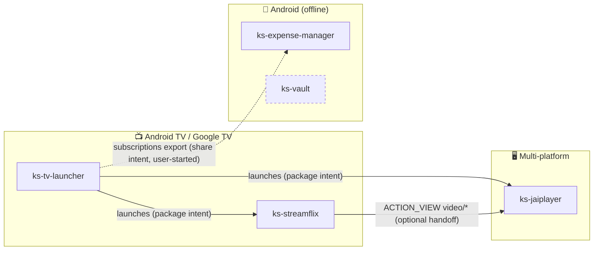

# KS-Suite

[](LICENSE)


**KS-Suite** is a family of free, privacy-focused apps for the living room, the desktop, and your pocket.
This repository is the suite's front door: it links to every app, and holds the conventions they all share. Each app lives in its own repository.

- **Private by default.** Your data stays on your device unless you choose otherwise.
- **Lean and fast.** No bloat, no ads and no tracking SDKs, with UIs tuned for the device in your hand or the remote on your couch.
- **One standard.** Shared conventions for code style, versioning, signing, and releases across every repository.

**Contents:** [Apps](#-apps) · [Getting the code](#-getting-the-code) · [Workspace layout](#-workspace-layout) · [How the apps relate](#-cross-repository-relationships) · [CI/CD](#-cicd-semantic-versioning--automated-signing) · [License](#-license)

---

## 📂 Apps

| App | What it does | Platform | Status |
|---|---|---|---|
| 📺 [**ks-tv-launcher**](https://github.com/kumarsumit17/ks-tv-launcher) | Ad-free, Apple TV-style launcher with a glass UI, a live weather widget, and a streaming-subscription tracker with renewal reminders. | Android TV / Google TV | ✅ Released · [v0.7.3](https://github.com/kumarsumit17/ks-tv-launcher/releases) |
| ▶️ [**ks-jaiplayer**](https://github.com/kumarsumit17/ks-jaiplayer) | Multi-platform media player with a shared Kotlin core and a native playback engine on each target. | Android · Google TV · Windows · macOS | 🛠 Planned |
| 🎬 [**ks-streamflix**](https://github.com/kumarsumit17/ks-streamflix) | Lean, D-pad optimized streaming media manager with fast focus navigation. | Android TV | 🛠 Planned |
| 🔐 [**ks-vault**](https://github.com/kumarsumit17/ks-vault) | Fully offline secure vault and notekeeper behind pattern/password authentication, for notes, government IDs, and tickets. | Android | 🛠 Planned |
| 💰 [**ks-expense-manager**](https://github.com/kumarsumit17/ks-expense-manager) | Minimalist, privacy-first personal finance and expense tracker. | Android | 🛠 Planned |
| ⬇️ [**ks-download-manager**](https://github.com/kumarsumit17/ks-download-manager) | Free download manager for images, audio and video, with up to 20× faster downloads. | Windows · macOS (Chrome extension under consideration) | 🛠 Planned |

"Planned" means the repository holds the project structure and its rules, with app code still to come.

### Tech stacks

| App | Stack |
|---|---|
| `ks-tv-launcher` | Kotlin · Jetpack Compose for TV (tv-material) · DataStore · Coil · WorkManager |
| `ks-jaiplayer` | Kotlin Multiplatform · Compose Multiplatform · Media3/ExoPlayer · VLCJ |
| `ks-streamflix` | Kotlin · Jetpack Compose for TV · Media3/ExoPlayer · Room · Hilt |
| `ks-vault` | Kotlin · Jetpack Compose · Room + SQLCipher · Android Keystore · BiometricPrompt |
| `ks-expense-manager` | Kotlin · Jetpack Compose · Room · Vico · DataStore |
| `ks-download-manager` | Kotlin · desktop UI and download engine to be decided |

---

## 🚀 Getting the code

Each app is a separate repository, so clone only what you need. To recreate the whole workspace:

```bash
git clone https://github.com/kumarsumit17/KS-Suite.git
cd KS-Suite
for app in ks-tv-launcher ks-jaiplayer ks-streamflix ks-vault ks-expense-manager ks-download-manager; do
  git clone "https://github.com/kumarsumit17/$app.git"
done
```

The app folders are git-ignored here, so this repository never tracks their contents. Builds need **JDK 17**; each app's own `README.md` has its build and install steps.

---

## 🗂 Workspace Layout

```
KS-Suite/
├── README.md               ← you are here
├── CLAUDE.md               ← suite-wide rules for AI-assisted work
├── LICENSE
├── .gitignore              ← ignores the app folders (each is its own repo)
├── ks-tv-launcher/         ← git repo
├── ks-jaiplayer/           ← git repo (KMP: shared/, androidApp/, desktopApp/)
├── ks-streamflix/          ← git repo
├── ks-vault/               ← git repo
├── ks-expense-manager/     ← git repo
└── ks-download-manager/    ← git repo
```

Each app repository contains:

```
<app>/
├── .github/workflows/release.yml   ← standardized release pipeline
├── .gitignore                      ← build output, .gradle/, keystores
├── CLAUDE.md                       ← stack, platform constraints, build commands
├── app/ (or shared/ + platform apps)
├── docs/
├── LICENSE
└── README.md
```

---

## 🕸 Cross-Repository Relationships

The apps share **no code and no runtime services**. Each one builds, ships, and works alone.
Every link between them is an explicit Android intent that the user starts. Each link is listed below so that a change to one side can be checked against the other.



### Edge contracts

| From → To | Mechanism | Contract | Fallback if target missing |
|---|---|---|---|
| `ks-tv-launcher` → `ks-streamflix`, `ks-jaiplayer` | `PackageManager.getLeanbackLaunchIntentForPackage` | Target package IDs `com.ks.streamflix`, `com.ks.jaiplayer` | Tile hidden |
| `ks-streamflix` → `ks-jaiplayer` | `ACTION_VIEW`, MIME `video/*`, explicit package | JaiPlayer must keep its `ACTION_VIEW` intent filter | Built-in ExoPlayer |
| `ks-tv-launcher` ⇢ `ks-expense-manager` | `ACTION_SEND`, `text/csv` | Columns `name,amount_minor,currency,cycle,next_due` | Standard share sheet |
| `ks-vault` | none | **Isolated by design**: no outbound links and no network | — |
| `ks-download-manager` | none | Standalone: no links to other apps | — |

### Shared conventions (not shared code)

| Concern | Convention | Defined in |
|---|---|---|
| Language / build | Kotlin, Gradle KTS, version catalog, JDK 17 | root `CLAUDE.md` |
| Package root | `com.ks.<app>` | root `CLAUDE.md` |
| TV UX | D-pad first, 48dp/27dp overscan margins | `ks-tv-launcher`, `ks-streamflix`, `ks-jaiplayer` `CLAUDE.md` |
| Privacy | No analytics/ads SDKs; vault and expense apps have no `INTERNET` permission | each `CLAUDE.md` |
| Release | Tag-driven SemVer and CI signing | below |

> When an edge contract changes, update this table and the `CLAUDE.md` files on **both** sides in the same release cycle.

---

## 🚀 CI/CD: Semantic Versioning & Automated Signing

Every repository ships the same GitHub Actions pipeline in `.github/workflows/release.yml`.

### 1. Versioning (SemVer 2.0)

- Versions follow `MAJOR.MINOR.PATCH`:
  - **MAJOR** for breaking changes or data migrations that can't be reversed
  - **MINOR** for backward-compatible features
  - **PATCH** for bug fixes
- Commit messages follow [Conventional Commits](https://www.conventionalcommits.org/) (`feat:`, `fix:`, `feat!:`, `chore:`…), so the next version and the release notes can be derived from history.
- A release is triggered by pushing an annotated tag:

  ```bash
  git tag -a v1.4.2 -m "v1.4.2"
  git push origin v1.4.2
  ```

- The workflow derives both Android version fields from the tag:

  | Field | Formula | `v1.4.2` → |
  |---|---|---|
  | `versionName` | tag without the `v` | `1.4.2` |
  | `versionCode` | `MAJOR × 10000 + MINOR × 100 + PATCH` | `10402` |

  They are passed to Gradle as `-PversionName` / `-PversionCode`. MINOR and PATCH must stay below 100.

### 2. Automated Signing

Keystores **never** enter source control. `*.jks`, `*.keystore`, and `keystore.properties` are git-ignored in every repo.

Configure these **repository secrets** (Settings → Secrets and variables → Actions):

| Secret | Contents |
|---|---|
| `KEYSTORE_BASE64` | `base64 -i release.jks` output |
| `KEYSTORE_PASSWORD` | Keystore password |
| `KEY_ALIAS` | Signing key alias |
| `KEY_PASSWORD` | Signing key password |

At build time the workflow decodes the keystore into `$RUNNER_TEMP` and exposes it through `SIGNING_*` environment variables. It deletes the keystore when the job finishes, even if the job fails. Gradle reads the variables like this:

```kotlin
signingConfigs {
    create("release") {
        storeFile = System.getenv("SIGNING_STORE_FILE")?.let(::file)
        storePassword = System.getenv("SIGNING_STORE_PASSWORD")
        keyAlias = System.getenv("SIGNING_KEY_ALIAS")
        keyPassword = System.getenv("SIGNING_KEY_PASSWORD")
    }
}
```

For local release builds, keep the same four values in an untracked `keystore.properties`.

### 3. Pipeline Stages

```
tag push v*.*.*
   │
   ├─▶ checkout → JDK 17 → Gradle cache
   ├─▶ derive versionName / versionCode from tag
   ├─▶ decode keystore from secrets
   ├─▶ build signed APK + AAB          (jaiplayer also builds Windows .msi/.exe and macOS .dmg)
   ├─▶ publish GitHub Release with auto-generated notes and artifacts
   └─▶ wipe keystore
```

---

## 📜 License

All KS-Suite projects are released under the **MIT License**. See [LICENSE](LICENSE).

Copyright © 2026 Kumar Sumit
