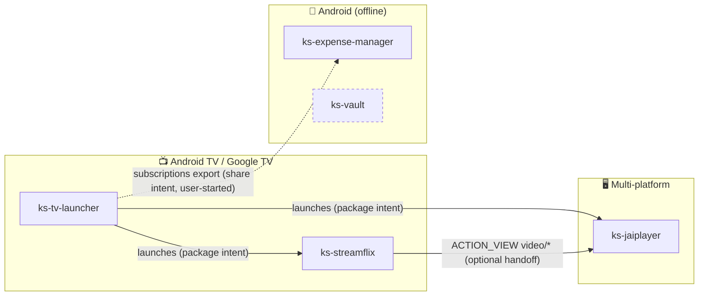

# Cross-repository relationships

The apps share **no runtime services** and never depend on each other. Each one builds, ships, and works alone. The only shared code is generic utilities in [`ks-utility`](https://github.com/kumasumit/ks-utility), which every app takes as a dependency pinned to a version tag.
Every link between them is an explicit Android intent that the user starts. Each link is listed below so that a change to one side can be checked against the other.

## Edge contracts

| From → To | Mechanism | Contract | Fallback if target missing |
|---|---|---|---|
| `ks-tv-launcher` → `ks-streamflix`, `ks-jaiplayer` | `PackageManager.getLeanbackLaunchIntentForPackage` | Target package IDs `com.ks.streamflix`, `com.ks.jaiplayer` | Tile hidden |
| `ks-streamflix` → `ks-jaiplayer` | `ACTION_VIEW`, MIME `video/*`, explicit package, `EXTRA_TITLE` | JaiPlayer must keep its `ACTION_VIEW` intent filter, which accepts `http`/`https` stream links (JaiPlayer v1.0.4+): StreamFlix sends signed links that need no header, and plain http is allowed for the home server. StreamFlix shows the button only when the intent resolves | Built-in ExoPlayer |
| `ks-tv-launcher` ⇢ `ks-expense-manager` | `ACTION_SEND`, `text/csv` | Columns `name,amount_minor,currency,cycle,next_due` | Standard share sheet |
| `ks-vault` | none | **Isolated by design**: no outbound links and no network | — |
| `ks-download-manager` | none | Standalone: no links to other apps | — |
| `ks-utility` → Kotlin apps | Git submodule at `ks-utility/`, `includeBuild("ks-utility/kotlin")`, dependency `com.ks:utility` | Generic utilities only, standard library only, plain Kotlin/JVM; the app pins a version tag. The Gradle wiring is added when an app's Gradle build is created; `ks-tv-launcher` has not committed the submodule yet | — |
| `ks-utility` → `ks-download-manager` | Git dependencies in `package.json` and `src-tauri/Cargo.toml` | Root `package.json` exports `typescript/src/index.ts`; crate `ks-utility` in `rust/`; the app pins a version tag | — |

> When an edge contract changes, update this table and the `CLAUDE.md` files on **both** sides in the same release cycle.

## The landing-page card
Every app repository keeps a `ks-suite.json` at its root: its card on the KS-Suite landing page (name, group, icon, platforms, stack, English and Hindi tagline). The Pages workflow here reads it from the default branch every hour; adding the file to a new repository is all it takes to list the app. Format and rules: [Landing page](landing-page.md#the-app-card-ks-suitejson). When an app changes its platforms or description, it updates its own card.

## Shared code

`ks-utility` is a build-time dependency only: it adds no runtime link between apps. An app gets a change to it only when the app moves its pinned version tag (a pushed tag never moves), or, in a DEV build only, when it tries a ks-utility `dev` commit ([below](#trying-ks-utility-changes-in-a-dev-build)). Every app moves to each new tag the same day it is released (below), so `ks-utility` never changes the meaning or signature of a function that is in use. The mechanism is described in [ks-utility's usage spec](https://github.com/kumasumit/ks-utility/blob/main/specs/usage.md).

## Moving to a new ks-utility tag

Owner's rule (2026-11-27, replacing "before each release"): when ks-utility pushes a `vX.Y.Z` tag, every app moves to it the same day.

- **ks-utility tags at most once a day** (owner's decision, 2026-11-27): it collects its changes on `dev` and releases them together, an urgent security fix excepted. `ks-suite-check` stays strict (the pin must be the newest tag), and an app release takes about 1.5 hours, so tags in quick succession would stop every app's release in progress.

- **What moves:** the Kotlin apps' `ks-utility/` submodule; the Tauri apps' git tag in `package.json` and `src-tauri/Cargo.toml` and their lock files.
- **Shared workflows are called at `@main`** (owner's decision, 2026-11-27): every `uses: kumasumit/ks-utility/.github/workflows/…` in an app says `@main`. ks-utility's `main` only fast-forwards at a release, so `@main` is always the newest ks-utility release; there are no workflow refs to move and no token that can change workflow files. `ks-suite-check` requires `@main` (ks-utility v0.18.0 and later); a rehearsal may call `@dev`, so a shared-workflow change can be tried from one app before ks-utility tags it.
- **How:** its own commit, `chore: move ks-utility to vX.Y.Z`, tested as usual and pushed to `dev`. The move never starts a production release by itself: a new ks-utility version reaches users with the app's next approved release ([Release cycle](release-cycle.md#a-new-ks-utility-version)).
- **Automated:** each app has a small `.github/workflows/ks-utility-bump.yml` that calls ks-utility's bump workflow. It runs when ks-utility's tag push dispatches it (`repository_dispatch`) and once a day as a safety net. GitHub runs `repository_dispatch` and schedules only from the default branch, so an app's bump starts working once its caller is on `main`, after its next release. The bump pushes to `dev` only when the app's tests pass; when they fail it opens an issue and the owner is notified, and nothing is released while a test fails.
- **Checked:** `ks-suite-check` in the shared release workflows (ks-utility v0.15.0 and later) refuses to release an app whose pin is not the newest ks-utility tag.
- **Started by** ks-utility's `notify-apps.yml` on every tag push, using the `KS_APPS_DISPATCH_TOKEN` secret; each app's `ks-utility-bump.yml` follows the example in ks-utility's [release workflow spec](https://github.com/kumasumit/ks-utility/blob/main/specs/release-workflow.md).
- **Owner step (done 2026-11-27):** one fine-grained GitHub token, owned by `kumasumit`, with Contents read and write on every app repository (90 days; renew before it expires), stored as the secret `KS_APPS_DISPATCH_TOKEN` in ks-utility, so its tag push can dispatch the app bumps. Without it, the daily schedule still moves every app within a day.
- **No workflow token:** apps have no `KS_WORKFLOWS_TOKEN`; the bump moves only the code pin, with GitHub's own token.
- Rules carried by the new tag reach the app through this move ([Rule architecture](rule-architecture.md)).

## Trying ks-utility changes in a DEV build

Owner's rule (2026-11-28): every app follows the DEV process for ks-utility, so a ks-utility change is tested in a real app before it is tagged. KS JaiPlayer is the first app to use it. Built on ks-utility `dev` (`e43563e`, release pull request [kumasumit/ks-utility#1](https://github.com/kumasumit/ks-utility/pull/1)).

1. **ks-utility first, untagged.** A ks-utility change lands on ks-utility's `dev` without a tag.
2. **The active app tries it in its DEV build.** In its own commit on the app's `dev`, the app pins ks-utility at a commit on ks-utility's `dev` that is ahead of the newest tag. Kotlin apps: the `ks-utility/` submodule. Tauri apps: `ks-utility.git#<commit>` in `package.json` and `rev = "<commit>"` in `src-tauri/Cargo.toml`, with their lock files. The DEV build then runs with its shared-workflow callers at `@dev`.
3. **Checked.** `ks-suite-check` accepts that pin only in a DEV build (a manual run), and only for a commit on ks-utility's `dev` that is ahead of the newest tag; it then runs from ks-utility's `dev`. A production release still needs the newest ks-utility tag and `@main`: a commit pin fails a release, and a branch pin always fails.
4. **Approval, tag, move back.** After the owner has tested the DEV build, the owner approves ks-utility's release pull request (`dev` to `main`), ks-utility is tagged, and the app moves to the new tag and its callers back to `@main` before its own production release ([Release cycle](release-cycle.md#a-new-ks-utility-version)).
5. **Never backwards.** The automatic move ([above](#moving-to-a-new-ks-utility-tag)) never moves a pin backwards: a pin ahead of the newest tag stays (ks-utility v0.19.1 and later). Until v0.19.1 is tagged, an app's daily move still runs v0.19.0 and can move a DEV pin back to that tag; re-pin before the next DEV build if it does.

