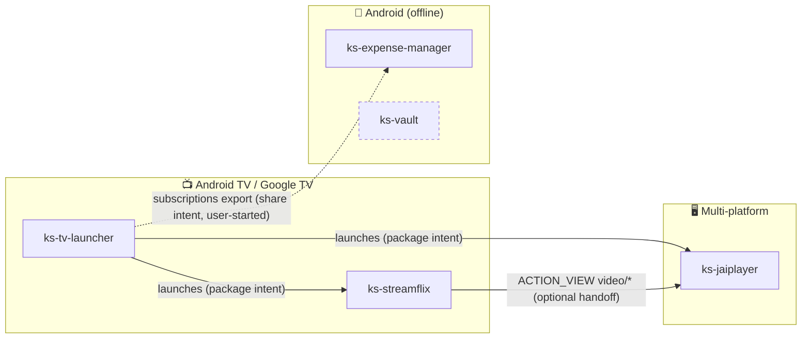

# Cross-repository relationships

The apps share **no code and no runtime services**. Each one builds, ships, and works alone.
Every link between them is an explicit Android intent that the user starts. Each link is listed below so that a change to one side can be checked against the other.

## Edge contracts

| From → To | Mechanism | Contract | Fallback if target missing |
|---|---|---|---|
| `ks-tv-launcher` → `ks-streamflix`, `ks-jaiplayer` | `PackageManager.getLeanbackLaunchIntentForPackage` | Target package IDs `com.ks.streamflix`, `com.ks.jaiplayer` | Tile hidden |
| `ks-streamflix` → `ks-jaiplayer` | `ACTION_VIEW`, MIME `video/*`, explicit package | JaiPlayer must keep its `ACTION_VIEW` intent filter | Built-in ExoPlayer |
| `ks-tv-launcher` ⇢ `ks-expense-manager` | `ACTION_SEND`, `text/csv` | Columns `name,amount_minor,currency,cycle,next_due` | Standard share sheet |
| `ks-vault` | none | **Isolated by design**: no outbound links and no network | — |
| `ks-download-manager` | none | Standalone: no links to other apps | — |

> When an edge contract changes, update this table and the `CLAUDE.md` files on **both** sides in the same release cycle.
